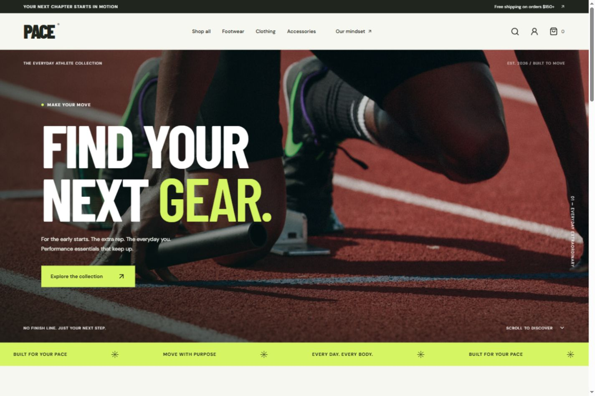

# PACE — sportswear concept store

Original full-stack portfolio project. React 19 + TypeScript + Vite, Express 5, and SQLite using Node's built-in `node:sqlite`. The supplied GitHub ZIP was reviewed as a feature reference; no source or branding was copied.



PACE is an editorial-style sportswear storefront concept with a responsive catalog, persistent shopping bag, demo checkout, customer accounts, and a protected admin studio.

## Screenshots

The preview above shows the responsive storefront landing page. The same interface includes product filtering, product detail and size selection, checkout confirmation, customer order history, and order management in the PACE studio.

## Run locally

Use **Node.js 24 or later**. Run these commands from this `pace` folder, not the parent school-management project:

```sh
npm install
npm run dev
```

Open **http://127.0.0.1:5174**. API runs at http://127.0.0.1:3002. No MongoDB, MySQL, cloud account, or `.env` file is required. Do not use `bun init`; the project is already configured. The server uses Node's SQLite API, so run the scripts with Node/npm.

## Explore

- Product catalog: search, category, size and price filtering, sorting, responsive imagery.
- Product details: size/color variants, stock availability, illustrative size guide.
- Cart: browser persistence, quantities, removal, free-shipping threshold.
- Guest or account demo checkout: server calculates prices, validates stock and variants, atomically saves order and reduces inventory.
- Customer accounts: password hashing with scrypt, expiring HttpOnly session cookies, private order history. Email format is checked; ownership verification and password reset are not implemented.
- Saved products: browser-local favorites, viewable from your account.
- Admin: product creation/editing, inventory, revenue overview, order details and fulfillment status.

Admin login: **admin@pace.demo** / **PaceStudio!2026**. Use the **PACE studio** link in the footer, or open `/#admin`. This credential is intended for local exploration only. Set `ADMIN_PASSWORD` before the first server start to create a different password. It does not change an already-created account. Keep the admin credential private if hosting a public demo.

Demo orders do not collect payments, send emails, ship products, or calculate real taxes. Use sample personal details. Product photography is bundled locally from Unsplash. Google Fonts require internet access; system fonts are used as fallback. Images illustrate the concept catalog and do not imply brand affiliation. Product descriptions and fit information are concept content, not claims about real merchandise.

SQLite data persists in `data/pace.db` (ignored from source control). Keep a persistent disk and regular backups if deploying. `DB_PATH` optionally changes its location; `PORT` defaults to 3002. `CLIENT_URL` optionally allows a separate frontend origin. When deploying behind HTTPS, set `NODE_ENV=production` for Secure cookies and serve the built app from the same origin. The server binds to loopback by default; adapt the bind address for your hosting provider.

## Verify and build

```sh
npm test
npm run build
npm start
```

After building, `npm start` serves both the API and frontend at http://127.0.0.1:3002. API regression tests use a separate in-memory database, not your saved demo data. They cover server-owned totals, stock rollback, variant validation, order isolation, session logout, admin authorization, product validation and origin rejection.

The project is prepared for local use; it is not deployed. Before presenting as a real store, implement real shipping/tax/return policies, production asset rights and hosting, email verification/recovery, monitoring and payment-provider integration.
